<div align="center">

# Forge

**A small Llama-style language model built from scratch: tokenizer, pretraining, inference engine and fine-tuning, plus a playground for looking inside it.**


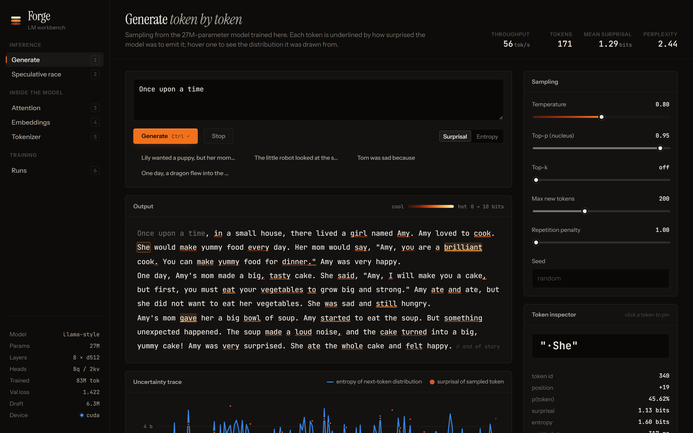

</div>

This repo doesn't use `transformers`, `tokenizers` or `peft`. Everything below is implemented here and covered by
tests. I wanted to understand every layer of a modern LLM stack well enough to measure it and defend it, on one
consumer GPU, and that includes the results that didn't go the way the papers suggest.

## Highlights

- A 26.7M-parameter Llama-style model (RoPE, grouped-query attention, SwiGLU, RMSNorm, tied embeddings) trained from scratch on TinyStories with a 75-minute wall-clock budget on an RTX 3080. Validation loss is 1.423 (perplexity 4.15, 0.494 bits/byte) on the full 5.3M-token held-out set, and it writes coherent stories ([samples](#pretraining)).
- A byte-level BPE tokenizer that trains in about 5 s (incremental pair counts and a lazy max-heap). Loaded with OpenAI's merges, the same encoder matches `tiktoken`'s cl100k token for token.
- FlashAttention-style memory-efficient attention as a custom autograd function, since torch 1.13 has no fused kernel. Peak training memory drops 33% (4.95 → 3.34 GB) and gradients match the naive version to 1e-15.
- A static-shape decoder captured as a CUDA graph: 590 tok/s against 89 tok/s for the same KV-cached decode in eager PyTorch (6.6×).
- Speculative decoding with a 6M draft model, tested to sample exactly from the target's distribution. It averages 3.3 tokens per target pass and is 1.67× faster on CPU and 1.27× on GPU in eager mode. Under CUDA graphs it's slower, and the [cost model](#speculative-decoding) explains why.
- LoRA written from scratch. Adapting the story model to Shakespeare with 0.9% of the parameters recovers 87% of full fine-tuning's loss reduction, from a 1 MB adapter.
- A playground (FastAPI and a hand-written SVG/canvas UI) with token-level surprisal, a live speculative-decoding race, an attention-head atlas, a t-SNE embedding map, a tokenizer comparison and live training dashboards.

<p align="center">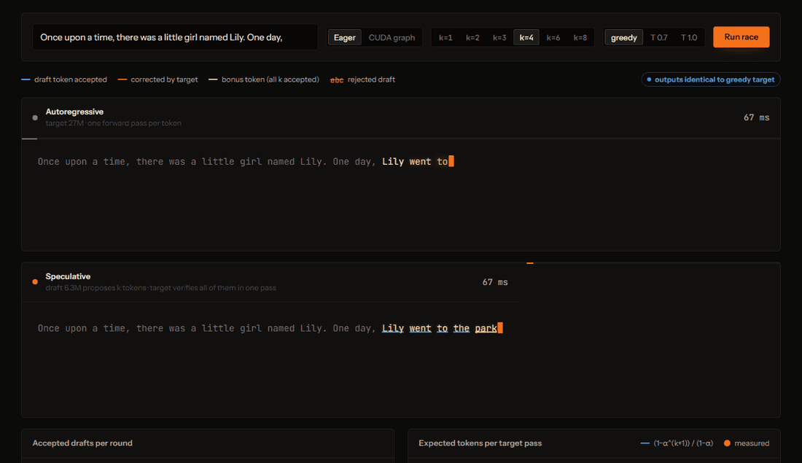</p>

## Results at a glance

| | |
|---|---|
| Model | 26.7M params · 8 layers · d = 512 · 8 query / 2 KV heads · context 512 · vocab 8,192 |
| Training | 83.1M tokens · 2,537 steps × 32,768 tokens · 75 min · bf16 · AdamW · warmup + time-budgeted cosine |
| Held-out loss / perplexity | **1.423 / 4.15** (0.494 bits per UTF-8 byte), full validation set, exported bf16 weights |
| Draft model | 6.3M params · 2 layers · 66M tokens in 25 min · val loss 1.660 |
| Tokenizer | 8,192-token BPE · 4.18 bytes/token on TinyStories (cl100k: 4.15 with 12× the vocabulary) |
| Decoding (greedy, batch 1, GPU) | no cache 80 · KV cache 89 · **KV cache + CUDA graph 590** tok/s |
| KV cache on CPU | **6.6×** faster than recomputation at 240 new tokens (84 vs 13 tok/s) |
| Speculative (greedy, k = 4) | α = 0.58 · 3.30 tokens / target pass · **1.67× CPU · 1.27× GPU eager** · 0.78× GPU graph |
| LoRA on Shakespeare (val loss, base 6.47) | r = 4: **4.26** (242K params) · r = 16: 4.06 (967K) · full FT: 3.92 best, 3.98 final (26.7M) |
| Tests | 70 tests, CPU-only, ~30 s · `ruff` clean |

All GPU numbers come from my desktop RTX 3080 while it was also busy with other work, so absolute throughput is lower
and noisier than on an idle card (training swung between 13K and 60K tokens/s). Every A-vs-B comparison below was
measured back-to-back under the same conditions.

---

## Contents

[Architecture](#architecture) · [Pretraining](#pretraining) · [Inference engine](#inference-engine) ·
[Fine-tuning with LoRA](#fine-tuning-with-lora) · [Tokenizer](#tokenizer) · [Inside the model](#inside-the-model) ·
[The playground](#the-playground) · [Quickstart](#quickstart) · [Repository map](#repository-map) ·
[Design notes](#design-notes) · [Testing](#testing) · [Limitations and next steps](#limitations-and-next-steps) · [References](#references)

## Architecture

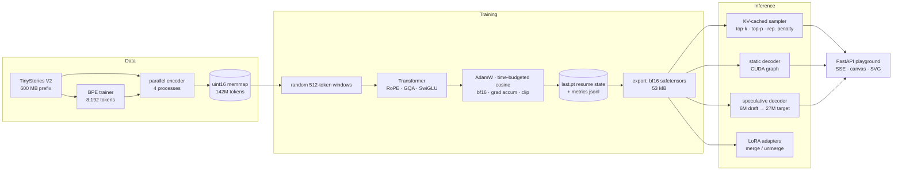

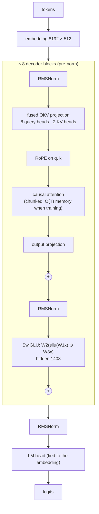

## Pretraining

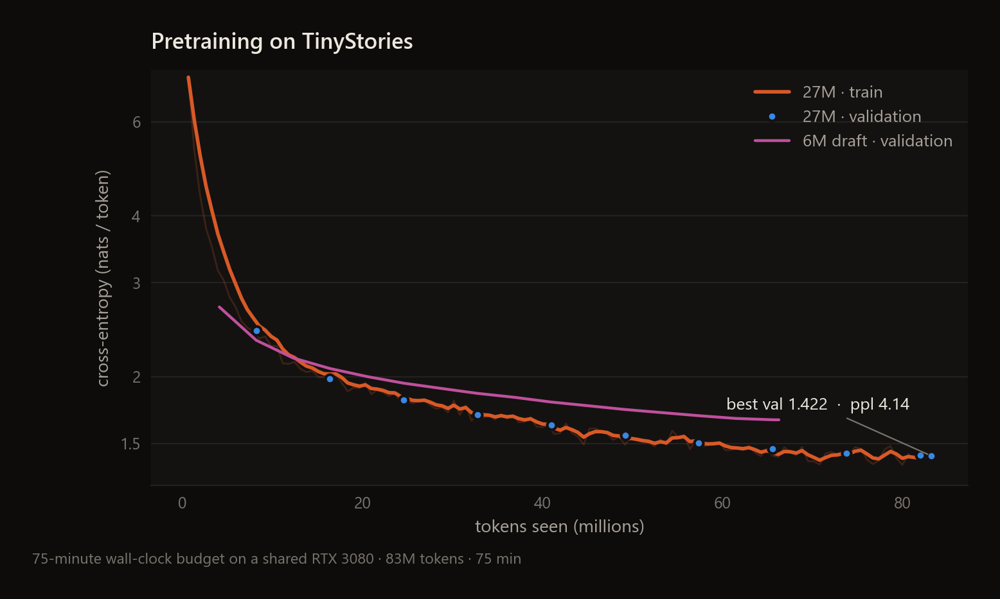

The 26.7M model saw 83M tokens, about 3 tokens per parameter. That's far below Chinchilla's ~20, so the run is
compute-limited rather than data-limited (the 142M-token corpus was never exhausted), and validation loss was still
falling when the budget ran out. The 6.3M draft model, trained for 25 minutes on the same data, plateaus at 1.66.
That gap is what speculative decoding has to work with.

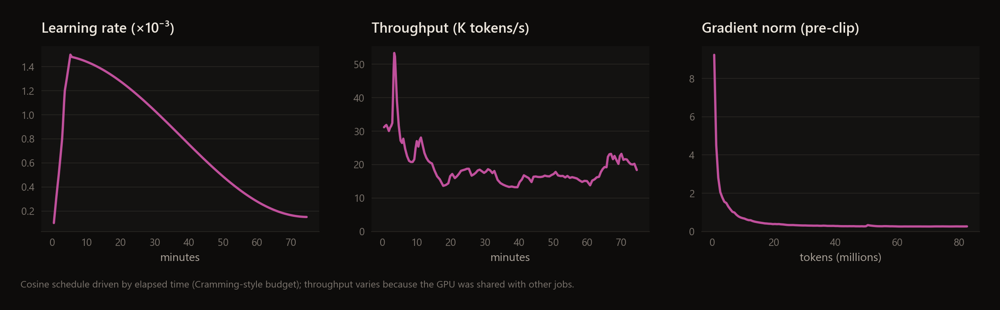

The learning-rate schedule runs on elapsed time instead of steps ([design note](#design-notes)). That's why it stays
smooth even though throughput (median 18.7K tokens/s, median MFU 5.8%) varied 4× with load on the machine. The run
also crashed once: a cuBLAS internal error at minute 50, when the machine ran out of host memory. I resumed it from
the step-1,750 checkpoint with the optimizer moments, RNG streams and elapsed time restored, so the schedule and the
loss curve continue without a seam.

Samples (temperature 0.8, top-p 0.95, prompt in bold, first sample per seed, not cherry-picked):

> **Once upon a time, there was a little girl named Lily.** She had a big, blue bag with her. One day, she went with her
> mom to the park. Lily was very happy. At the park, Lily saw a little boy named Tom. Tom was sad. Lily asked, "Why are
> you sad, Tom?" Tom said, "I lost my toy." Lily wanted to help Tom feel better. Lily had an idea. She took her big,
> blue bag and put it in the bag. Tom saw the bag and opened it. They both looked at the bag. It was empty!

> **The little robot was sad because** he did not have any friends. He tried to find a friend to play with, but he could
> not find anyone. Then, a kind bird saw the little robot and said, "Why are you sad, little robot?" The little robot
> said, "I want a friend to play with me, but I cannot find anyone to play with." …

> **Sara found a strange key under her bed.** She thought it was very pretty. She showed the key to her mom. Her mom
> told her to share it with the dog. The dog was happy and wagged its tail. Sara and her mom played with the dog and had
> lots of fun.

Grammar, dialogue and story arcs are solid. Object permanence isn't ("put it in the bag", then "It was empty!"),
which is about what you'd expect from 27M parameters and 83M tokens. All four samples are in `results/eval_main.json`.

## Inference engine

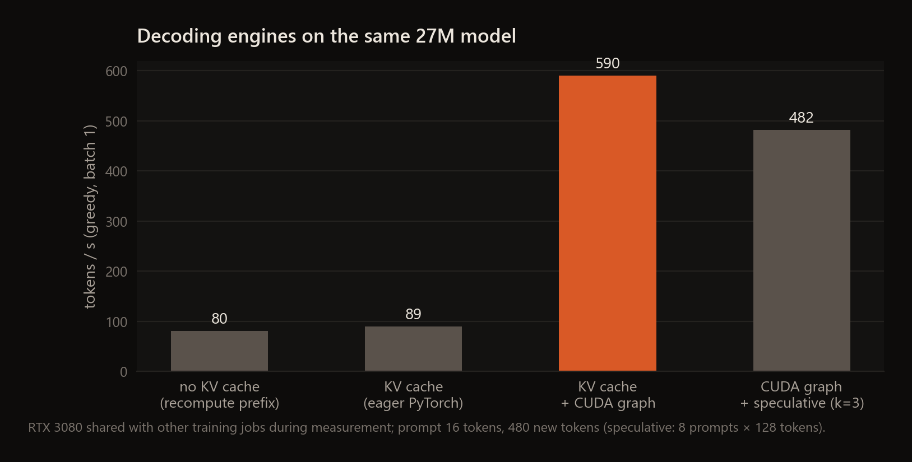

### KV cache, and why it barely helps on this GPU

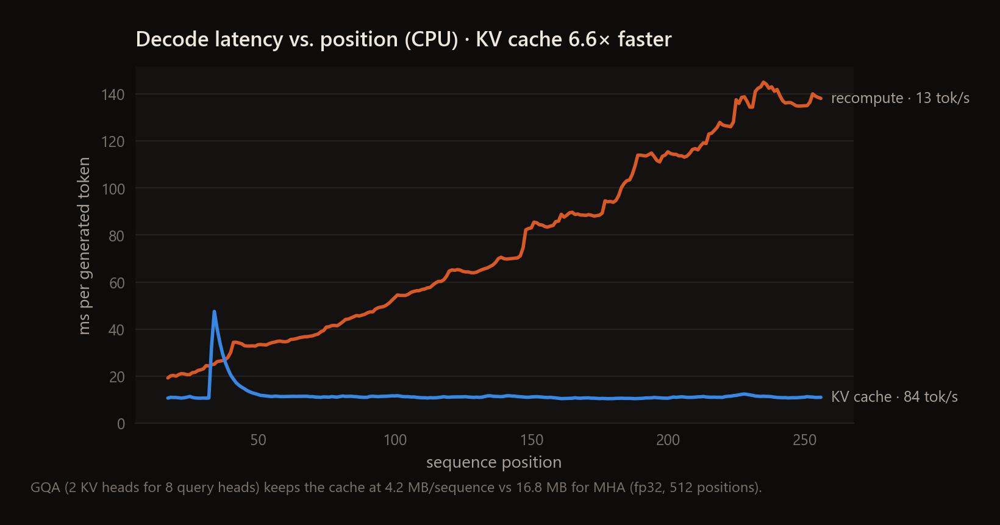 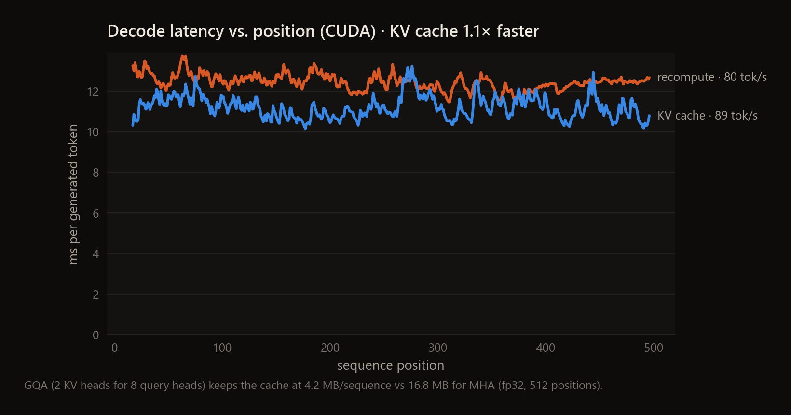

On the CPU the cache does what the textbook says. Without it, every step re-runs the model over the whole prefix, so
latency grows linearly with position (136 ms per token at position 256), while cached decoding stays flat at about
11 ms. Over 240 tokens that's 6.6× faster. On the GPU in eager PyTorch the gain is only 1.1×. One decode step is
around 200 tiny kernels, and at 27M parameters the GPU finishes each one faster than Python can launch the next. The
step is launch-bound, so saving FLOPs the GPU wasn't short of doesn't change much.

The fix is to get rid of the launches. `forge/fastpath.py` rewrites the cached forward with static shapes: the KV
cache is written with `index_copy_` at a position held in a device tensor, attention always spans all 512 slots with a
`key_pos ≤ query_pos` mask, and RoPE tables are gathered on the device. One decode step can then be captured once as a
CUDA graph and replayed with a single launch, and greedy generation needs no host synchronisation until the end. The
result is 590 tok/s, 6.6× the eager cached decode, with bit-identical outputs (tested).

At this size GQA helps memory, not speed. With 2 KV heads the cache is 4.2 MB per 512-token sequence instead of
16.8 MB with multi-head attention, and that's the number that bounds batch size when serving.

### Speculative decoding

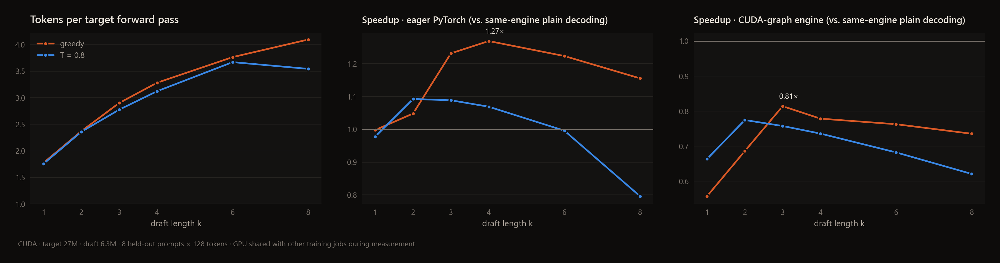

| greedy, 8 held-out prompts × 128 tokens | k = 1 | k = 2 | k = 3 | k = 4 | k = 6 | k = 8 |
|---|---|---|---|---|---|---|
| acceptance rate α | 0.78 | 0.69 | 0.64 | 0.58 | 0.47 | 0.40 |
| tokens per target forward pass | 1.77 | 2.37 | 2.90 | **3.28** | 3.76 | 4.10 |
| speedup · GPU, eager | 1.00× | 1.05× | 1.23× | **1.27×** | 1.22× | 1.16× |
| speedup · GPU, CUDA graphs | 0.56× | 0.69× | **0.81×** | 0.78× | 0.76× | 0.74× |
| speedup · CPU (k ∈ {2, 4, 6}) | n/a | 1.63× | n/a | **1.67×** | 1.45× | n/a |

Output is identical to plain greedy decoding in every greedy configuration (the benchmark checks each prompt).

Why does it win in eager mode and lose under CUDA graphs? The speedup is roughly
`tokens_per_pass / (1 + k·c + overhead)`, where `c` is the cost of a draft step relative to a target step. I measured
`c` directly (`results/cost_ratio_cuda.json`):

| | target step (T=1) | target verify (T=5) | draft step | c |
|---|---|---|---|---|
| eager | 13.3 ms | 13.3 ms | 4.7 ms | 0.35 |
| CUDA graph | 1.58 ms | 2.08 ms | 0.45 ms | 0.29 |

In eager mode verification is free: checking 5 tokens costs the same 13.3 ms as checking 1, because the step is
launch-bound. The cost model predicts `3.28 / (1 + 4 · 0.354) = 1.36×` and I measure 1.27×. Under CUDA graphs the
round itself is still fast (`4 · 0.45 + 2.08 = 3.9 ms` for 3.3 tokens, against `3.3 · 1.58 = 5.2 ms`), but the glue
between graphs (sampling, accept/reject, concatenation and one host sync per round) runs eagerly and costs more than
the round saves. Capturing the whole draft-verify-accept round as one graph would take Python out of the loop; that's
the next thing I'd build. At 7B or 70B scale, where a target step is memory-bandwidth-bound and costs 10–50× a draft
step, this overhead stops mattering and the usual 2–3× speedups show up.

### Memory-efficient attention (training)

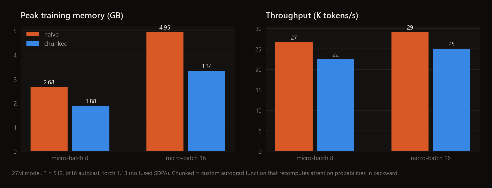

Naive attention keeps every layer's (B, H, T, T) probability tensor alive for the backward pass. The chunked version
saves only the output and the row log-sum-exp, and recomputes probabilities block by block during backward. Peak
memory falls 30% at micro-batch 8 and 33% at micro-batch 16, and throughput drops 14–16% because of the Python-level
loop and the recompute. It's the FlashAttention algorithm, not a fused kernel. That trade is what kept the training
run under a 4 GB memory budget (peak 3.45 GB).

## Fine-tuning with LoRA

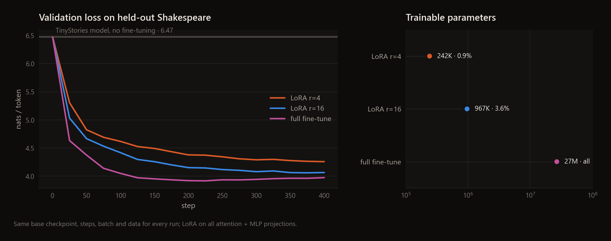

Every run uses the same base checkpoint, data (TinyShakespeare, 90/10 split), batch size, 400 steps and evaluation
windows:

| | trainable params | adapter / weights file | Shakespeare val loss | share of full-FT gain |
|---|---|---|---|---|
| TinyStories model, no fine-tuning | n/a | n/a | 6.47 | n/a |
| LoRA r = 4 (α = 8), all projections | 242K (0.9%) | **1.0 MB** | 4.26 | 87% |
| LoRA r = 16 (α = 32) | 967K (3.6%) | 3.9 MB | 4.06 | 94% |
| Full fine-tune | 26.7M (100%) | 107 MB (fp32) | **3.92** best (step 225) → 3.98 final | 100% |

Full fine-tuning reaches the lowest loss but starts overfitting after about 225 steps, since the training set is only
357K tokens. Both LoRA runs are still improving at step 400; the rank constraint acts as a strong regulariser. LoRA
wasn't faster in wall-clock terms here (2.3 vs 1.9 min). At 27M parameters the extra adapter matmuls cost more than
the optimizer-state savings, and LoRA's real wins (memory and storage) only matter at scale. Absolute losses are high
because the 8K-token story tokenizer splits Early Modern English into lots of short pieces (see the next section).

## Tokenizer

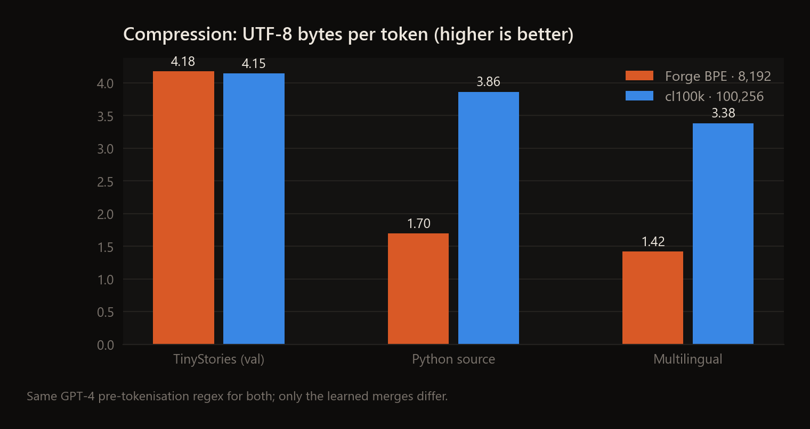

On its own distribution the 8,192-token vocabulary compresses as well as GPT-4's 100,256-token cl100k (4.18 vs 4.15
bytes/token), and the embedding matrix is 4.2M parameters (16% of the model) instead of about 51M. Off-distribution
it falls apart: 1.70 bytes/token on Python and 1.42 on mixed scripts, because the merges were only spent on byte
sequences that are common in children's stories. That's the cost of a small in-domain tokenizer, and the reason
tokenizers get trained on the model's actual data mixture.

## Inside the model

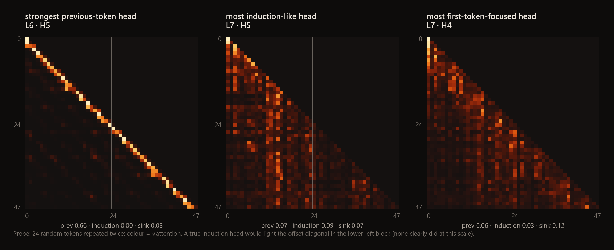

The head atlas scores all 64 heads on a probe of 24 random tokens repeated twice. Layer 6 head 5 is a clean
previous-token head, with 66% of its attention on the preceding position. A strong induction head never formed: the
best induction score is 0.09, and the offset-diagonal pattern from Olsson et al. isn't there. I think that's plausible
for this data, since TinyStories rarely rewards copying arbitrary sequences and the model only saw 83M tokens. It's
also a good reminder to measure these circuits instead of assuming them. The playground computes the same scores live
and badges the heads in the atlas.

## The playground

`python -m forge.server`, then open <http://127.0.0.1:8001>. There are six views, all running on the real checkpoints:

| | |
|---|---|
| 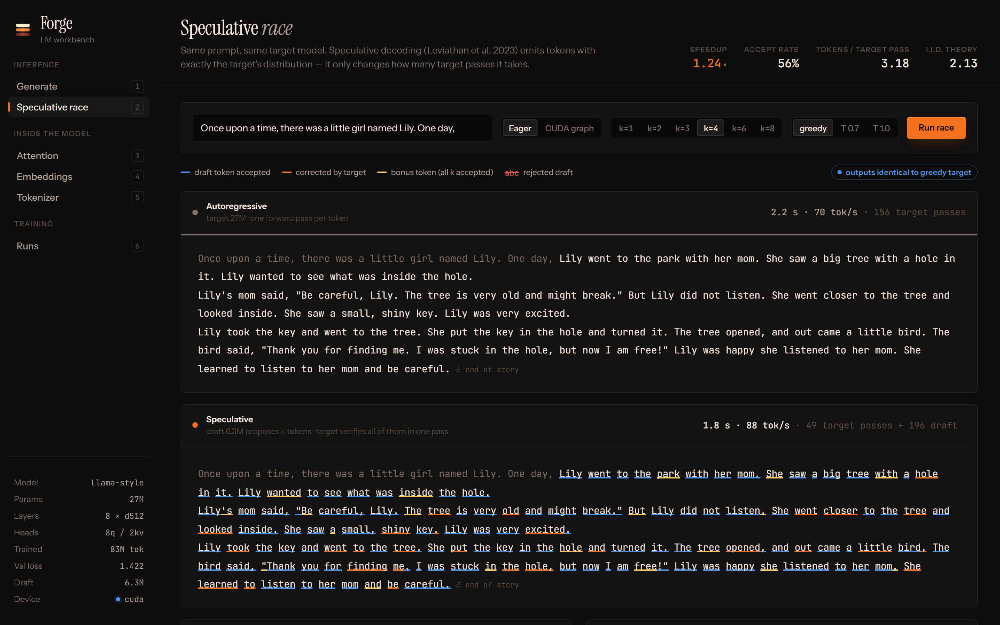 **Speculative race.** Plain vs speculative decoding replayed on the server's measured clock, with the eager or CUDA-graph engine. Shows accepted, corrected and bonus tokens, rejected drafts, and measured tokens per pass against the i.i.d. theory curve. | 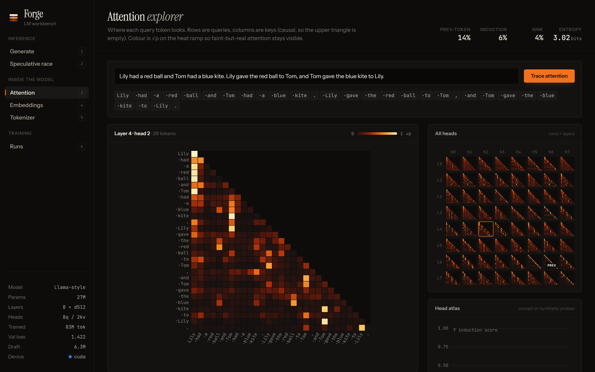 **Attention explorer.** Per-head heatmaps with a hover crosshair, plus a 64-head atlas that badges previous-token, induction and sink heads automatically. |
| 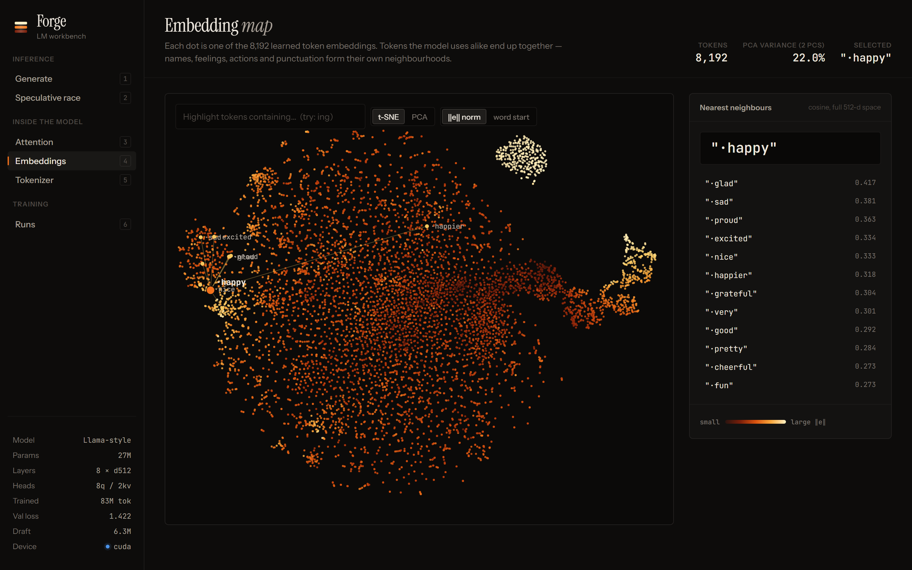 **Embedding map.** All 8,192 token embeddings in t-SNE (or PCA). Pan, zoom, search, and cosine nearest neighbours in the full 512-d space. | 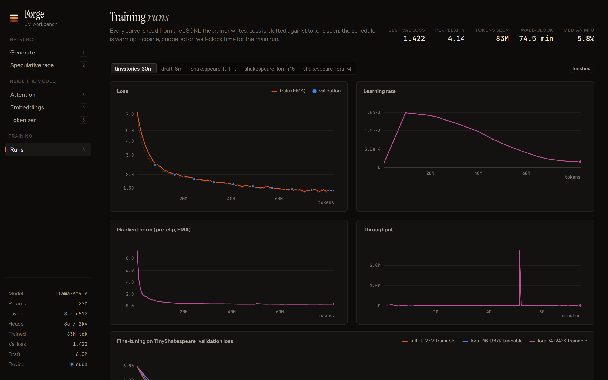 **Training runs.** Live curves from `metrics.jsonl` (they refresh while a run is writing) and the LoRA vs full fine-tune comparison. |
| 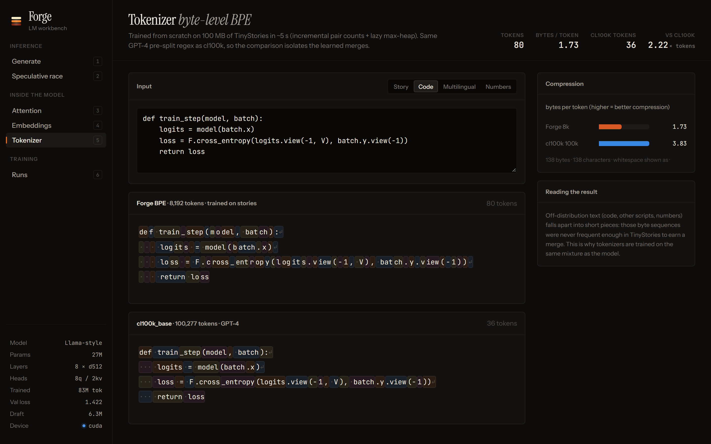 **Tokenizer.** Live segmentation, mine vs cl100k, with compression stats. |  **Generate.** SSE token streaming, each token's surprisal shown as heat, top-5 alternatives, and an entropy/surprisal trace. |

The UI has no framework and no CDN JavaScript: ES modules, hand-rolled SVG charts with crosshair tooltips, and a canvas
renderer for the heatmaps and the 8K-point scatter. One colour ramp runs through the whole app, from cold iron to
white-hot, and every intensity (surprisal, attention weight, embedding norm) uses it. Temperature is the dial you turn
when sampling, so a heat scale felt right. I checked the chart palette with a colour-vision-deficiency validator.

## Quickstart

```bash
pip install -e ".[dev]"            # torch, numpy, regex, fastapi, uvicorn, matplotlib, safetensors (+ pytest, ruff, tiktoken)

python -m forge.data download      # TinyStories valid + 600 MB train prefix, TinyShakespeare (~1 min)
python -m forge.tokenizer          # train the 8,192-token BPE on 100 MB (~5 s)
python -m forge.data tokenize      # encode to uint16 memmaps with 4 processes (~30 s)

python -m forge.train configs/tinystories-30m.json        # 26.7M model, 75-minute budget (add --resume after a crash)
python -m forge.train configs/draft-6m.json               # 6.3M draft model, 25-minute budget
python -m forge.export checkpoints/tinystories-30m/best.pt # weights-only bf16 safetensors (53 MB vs 321 MB)
python -m forge.export checkpoints/draft-6m/best.pt
python -m forge.train configs/lora-shakespeare.json       # LoRA r=4 on top of the exported model

python -m forge.server             # playground on http://127.0.0.1:8001
pytest                             # 70 tests, CPU-only
```

Benchmarks and figures: `python -m bench.eval_val`, `python -m bench.kv_cache`, `python -m bench.speculative` and
`python -m bench.attention_memory`, then `python scripts/make_figures.py` (writes `docs/assets/`). `make all` runs the
whole pipeline, and any config value can be overridden with `--set key=value`.

## Repository map

```
forge/
  tokenizer.py     byte-level BPE: trainer (incremental counts + lazy heap), encoder, tiktoken import
  data.py          download (HTTP Range), parallel tokenisation, memmap batch sampler
  model.py         Transformer: RMSNorm, RoPE, GQA, SwiGLU, KV cache, attention capture, FLOPs, safetensors I/O
  attention.py     chunked causal attention: custom autograd function, O(T) activation memory
  train.py         AdamW groups, warmup + time-budgeted cosine, bf16, accumulation, checkpoint/resume
  export.py        training checkpoint -> weights-only bf16 safetensors
  generate.py      sampling (temperature, top-k, top-p, repetition penalty) + per-token telemetry
  speculative.py   draft/verify loop, vectorised + fully on-device rejection sampling, cache rollback
  fastpath.py      static-shape decoder, CUDA-graph capture/replay, graphed speculative decoding
  lora.py          LoRALinear, inject/freeze, merge/unmerge, adapter-only checkpoints
  server.py        FastAPI: SSE generation, race, attention maps, head scores, embeddings (PCA/t-SNE), runs
bench/             eval_val · kv_cache · speculative · attention_memory   -> results/*.json
web/               the playground (ES modules, SVG/canvas, no build step)
configs/           JSON configs for every run in this README
scripts/           make_figures.py · screenshots.py / record_gif.py (headless Chrome over CDP)
tests/             tokenizer · model · generation · speculative · fast path · LoRA · server
docs/assets/       figures and screenshots
```

## Design notes

**Tokenizer training.** Text is pre-split with GPT-4's regex, so merges never cross word, number or punctuation
boundaries. 100 MB of TinyStories is 23.3M chunks but only 22.8K unique ones. Training keeps `pair → count`
(frequency-weighted), `pair → {words containing it}` and a max-heap of `(−count, pair)` with lazy invalidation, so each
merge only touches the words that contain the merged pair. Ties break on the smaller pair, which makes training
deterministic, and a test checks it merge-for-merge against a naive trainer that recounts everything.

**cl100k parity.** tiktoken only ships `bytes → rank`. I recover the merges by re-running BPE on each token's own bytes
with only lower-ranked merges allowed; the two parts left over are its merge pair. The encoder applies merges by
lowest rank through tiktoken's byte permutation and matches `tiktoken` on unicode, emoji, code and whitespace runs.

**RoPE.** Feature pairs are rotated by `m·θᵢ` with `θᵢ = 10000^(−2i/d)`, so `⟨R_m q, R_n k⟩ = ⟨q, R_{n−m} k⟩`. Keys are
cached after rotation, and a test checks the relative-position property directly.

**GQA.** `wqkv` projects to 8 query heads and 2 KV heads, and each KV head is broadcast to its 4 query heads with an
`expand`. A test builds the equivalent MHA model by repeating the K/V weights and checks the logits are identical.

**Chunked attention.** Forward: for each block of 128 queries, compute `S = QKᵀ·scale` against keys up to the end of
the block, apply the causal mask on the diagonal block, then `L = logsumexp(S)` and `O = exp(S − L)V`; save
`Q, K, V, O, L`. Backward recomputes `P = exp(S − L)` and uses `dV = Pᵀ dO`, `dP = dO Vᵀ`,
`dS = P ∘ (dP − rowsum(dO ∘ O))`, `dQ = dS K·scale`, `dK = dSᵀQ·scale`.

**Time-budgeted schedule.** `lr = lr_min + ½(lr_max − lr_min)(1 + cos(π · elapsed / budget))` after a 300-step warmup.
When the step rate is unpredictable, this still ends exactly at `lr_min` when the budget runs out. Elapsed time is
checkpointed, so a resumed run continues the same schedule, which is exactly what happened after the crash.

**Checkpoints.** `last.pt` (321 MB) holds the model, AdamW moments, RNG state and elapsed time for exact resumption.
Everything that only uses the model (the playground, benchmarks, fine-tuning) loads a weights-only bf16 safetensors
export instead (53 MB, with the tied LM head stored once).

**Speculative sampling.** Accept draft token `x` with probability `min(1, p(x)/q(x))`. At the first rejection, sample
from `norm(max(0, p − q))`, and if all `k` pass, sample a bonus token from `p_{k+1}`. Since
`min(p, q) + max(0, p − q) = p`, every emitted token is distributed exactly as under the target. The on-device version
pads `q` with a zero row so the bonus case becomes a special case of the residual formula, which makes the whole round
branch-free on the GPU.

**LoRA.** `W' = W + (α/r)·BA`, with `A` Kaiming-initialised and `B = 0`, so the model is unchanged at step 0 (tested).
`merge()` folds `BA` into `W` for zero-overhead inference, `unmerge()` restores `W`, and adapters are saved on their own.

## Testing

`pytest` runs 70 CPU-only tests in about 30 seconds.

- Tokenizer: incremental trainer matches the naive reference, parallel counting matches serial, round-trips on unicode, emoji and code, special tokens, save/load, and cl100k parity with tiktoken.
- Model: KV-cache logits match the full forward (mixed-size chunks and rollback), causality, the RoPE relative-position property, GQA vs MHA with repeated heads, chunked attention vs naive (forward and all three gradients in float64), attention rows are distributions, single-batch overfit, checkpoint and resume through the real `Trainer`, safetensors export round-trip with weight tying.
- Generation: top-k and top-p masks, greedy with and without cache, seeded sampling, stop token, sliding window past the context length.
- Speculative: the first-token marginal equals the target for both the host and the on-device rule (20K trials; the test fails if you sample from the draft instead), greedy speculative equals greedy target for k ∈ {1, 2, 4, 7}, the joint law of two sampled tokens against brute-force enumeration, and α = 1 for an identical draft.
- Fast path: static forward vs cached forward, graphed greedy vs eager greedy, graphed speculative greedy is exact, CUDA-graph replay vs eager (GPU only).
- LoRA: zero-init identity, only adapter parameters get gradients, merge vs unmerged, unmerge restores the weights, adapter round-trip.
- Server: every endpoint through ASGI, including SSE parsing, the greedy-race identity check and path-traversal rejection.

CI (`.github/workflows/ci.yml`) runs `ruff` and the test suite on CPU torch.

## Limitations and next steps

- Scale. 26.7M parameters and 83M tokens is about 3 tokens per parameter, and the loss curve hadn't flattened. With
  more compute I'd train 3–4 model sizes on the full 470M-token corpus and fit a loss-vs-compute curve instead of
  reporting one point.
- Speculative decoding under CUDA graphs loses to graphed plain decoding, because sampling, accept/reject and the host
  sync run eagerly between graph replays. Capturing the whole round as one graph, or trying a self-speculative
  early-exit draft, would fix that.
- Training kernels. The chunked attention is a Python-level loop. On torch 2.0+ the model switches to the fused
  `scaled_dot_product_attention` automatically. Median MFU was 5.8%; `torch.compile`, fused AdamW and an idle GPU are
  the obvious levers.
- Evaluation is perplexity, bits-per-byte and samples. A real model needs downstream evals (for example TinyStories'
  GPT-graded grammar, consistency and creativity scores) and the instruction-following variant.
- Serving handles one request at a time. Continuous batching with a paged KV cache is the natural next layer on top of
  the static decoder.
- No induction head formed at this scale. Tracking the head-atlas scores across checkpoints of a longer run would show
  whether and when one appears.

## References

- Vaswani et al., *Attention Is All You Need* (2017) · Touvron et al., *LLaMA* (2023)
- Su et al., *RoFormer: Rotary Position Embedding* (2021) · Ainslie et al., *GQA* (2023) · Shazeer, *GLU Variants Improve Transformer* (2020) · Zhang & Sennrich, *RMSNorm* (2019)
- Dao et al., *FlashAttention* (2022) · Rabe & Staats, *Self-attention Does Not Need O(n²) Memory* (2021)
- Leviathan et al., *Fast Inference from Transformers via Speculative Decoding* (2023) · Chen et al., *Accelerating LLM Decoding with Speculative Sampling* (2023)
- Hu et al., *LoRA* (2021) · Geiping & Goldstein, *Cramming* (2022) · Eldan & Li, *TinyStories* (2023) · Hoffmann et al., *Chinchilla* (2022)
- Sennrich et al., *Neural Machine Translation of Rare Words with Subword Units* (2016) · Radford et al., *GPT-2* (2019)
- Olsson et al., *In-context Learning and Induction Heads* (2022) · Xiao et al., *Attention Sinks* (2023)
- Holtzman et al., *The Curious Case of Neural Text Degeneration* (2019) · Keskar et al., *CTRL* (2019) · Chowdhery et al., *PaLM* (MFU accounting, 2022)

---

<sub>MIT licensed.</sub>
